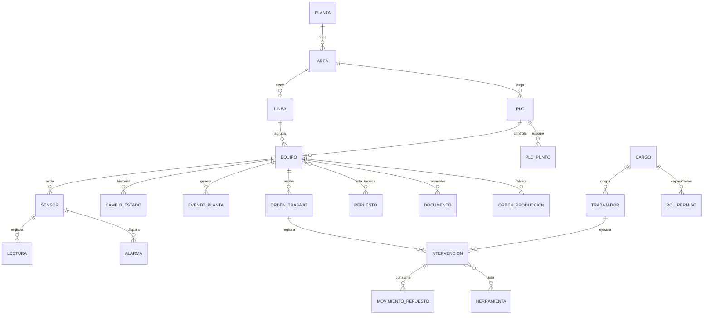

# SIMA 4.1 · Arquitectura de integración

Tres aplicaciones, un backend y una base de datos. Ninguna aplicación se conecta a PostgreSQL: todas pasan por la API.

```mermaid
flowchart LR
  subgraph Clientes
    W[SIMA Web<br/>Next.js · administración y supervisión]
    D[SIMA-Desktop.exe<br/>Tauri · operación y mantenimiento]
    S[SIMA-PLC-Simulator.exe<br/>Tauri · laboratorio de automatización]
  end
  subgraph Backend[Backend central · .NET 8]
    R[API REST<br/>JWT + permisos por cargo]
    H[SignalR /hubs/planta<br/>tiempo real]
    I[Ingesta de dispositivos<br/>clave de simulador / gateway]
    E[Servicio de estados y eventos<br/>EstadosEquipo · IngestaEventos]
  end
  DB[(PostgreSQL<br/>fuente única)]
  W -- REST + WebSocket --> R & H
  D -- REST + WebSocket --> R & H
  S -- REST (clave de dispositivo) --> I
  I --> E --> DB
  R --> E
  R --> DB
  E -- avisa --> H
  G[Gateway OPC UA / MQTT<br/>(futuro, PLC físicos)] -. clave gateway .-> I
```

## 1. Qué encontré al analizar la v4

| Problema | Riesgo | Solución en 4.1 |
|---|---|---|
| Zona y línea guardadas como texto en cada equipo, PLC, orden de producción e incidente | Nombres que divergen, búsquedas que no coinciden | Entidades `Planta → AreaPlanta → LineaProduccion` con claves foráneas. Migración que convierte los textos existentes sin perder datos |
| No se distinguía un dato simulado de uno real | Una alarma simulada podía pasar por real | `Plc.Origen` (`simulado`/`real`); `Simulado` en alarmas, eventos e historial; la credencial del simulador solo sirve para PLC simulados |
| Telemetría y eventos sin identificador del envío | Un reintento duplicaba alarmas u órdenes | Cada evento trae `uid` del origen; índice único en `eventos_planta.Uid`; lotes de telemetría con `uid` en caché de 10 min |
| Sin control de concurrencia | Dos técnicos podían tomar la misma orden; stock negativo con retiros simultáneos | Versión de fila (`xmin`) en equipos, órdenes de trabajo, órdenes de producción y repuestos; respuesta 409 automática; restricción `Stock >= 0` |
| El cambio de estado de un equipo estaba repartido en varios lugares | Historial incompleto | Un único servicio `EstadosEquipo.Cambiar` que registra parada, historial, evento y aviso en vivo |
| La reparación solo cerraba la orden | Sin trazabilidad de qué se hizo ni qué se consumió | `Intervencion` con diagnóstico, causa, acción, herramientas y repuestos, en una transacción |
| Sin historial de eventos separado de la auditoría | Telemetría, eventos y auditoría mezclados | Cuatro capas separadas (ver §3) |

## 2. Quién produce, consulta o modifica cada dato

| Dato | Web | Desktop | Simulador | Backend |
|---|---|---|---|---|
| Trabajadores, cargos, permisos | **crea / modifica** (RR. HH., TI) | consulta lo propio | — | valida acceso por cargo |
| Planta, áreas, líneas, equipos (datos maestros) | **crea / modifica** (`equipos.editar`) | consulta | consulta el catálogo con modelo de simulación | asigna identificadores únicos |
| PLC, módulos, puntos de E/S | consulta | consulta | consulta su configuración | — |
| Programa en escalera | consulta, **aprueba** cambios | consulta | **solicita** cambios | publica solo lo aprobado por otra persona |
| Estado físico del equipo (operando, alarma, detenido) | consulta | consulta | **produce** (PLC simulados) | aplica reglas; no pisa el estado de mantención |
| Estado administrativo (en mantención) | consulta | **produce** (tomar/cerrar OT con LOTO) | consulta (no cambia su física) | — |
| Telemetría (lecturas) | consulta | consulta | **produce** | abre/cierra alarmas, guarda historial cada 4 s |
| Eventos de planta | consulta | consulta y produce (mantenimiento) | **produce** | deduplica por `uid` |
| Alarmas | consulta, reconoce | consulta, reconoce | — (las genera el backend) | **produce** a partir de lecturas y eventos |
| Órdenes de trabajo | consulta, crea | **crea, toma, interviene, cierra** | — | crea órdenes automáticas ante fallas |
| Repuestos y herramientas | consulta, ingresa (pañol) | **consume** en intervenciones | — | descuenta stock en la misma transacción |
| Producción | planifica | registra (operadores) | **produce** conteos automáticos | alimenta el OEE |

## 3. Separación de la información

1. **Administrativa**: personas, cargos, permisos, estructura de planta, equipos, repuestos. Cambia poco, siempre con usuario y auditoría (`auditoria`).
2. **Estado operativo**: estado actual de cada equipo y PLC (`equipos.Estado`, `plc.Estado`) con su historial (`cambios_estado_equipo`, `paradas`).
3. **Telemetría**: lecturas de sensores (`lecturas`), con retención de 6 horas y un dato cada 4 s por sensor como máximo.
4. **Historial de eventos**: lo que ocurrió en planta (`eventos_planta`): fallas, arranques, paradas, cambios de PLC, mantenimientos, registros. Cada fila dice su origen (`simulador`, `gateway`, `web`, `desktop`, `sistema`) y si es simulada.

## 4. Contratos de comunicación

**REST (usuarios, con token JWT)**: `/api/estructura`, `/api/equipos/{codigo}` (ficha completa), `POST/PUT /api/equipos` (con `version`), `/api/eventos`, `/api/operacion/resumen`, `/api/ordenes/{id}`, `POST /api/ordenes/{id}/intervenciones`, más todos los de la v4.

**SignalR `/hubs/planta`** (web y Desktop): `lecturas`, `equipo`, `alarma`, `orden`, `plc`, `plcIO`, `evento`, `intervencion`, `estructura`, `produccion`, `calidad`, `sst`, `cambioPlc`, `cuentaCerrada`.

**Ingesta de dispositivos (cabecera `X-API-Key`)**:

| Método | Ruta | Uso |
|---|---|---|
| GET | `/api/ingesta/plc` | PLC que esta credencial puede alimentar |
| GET | `/api/ingesta/plc/{codigo}/config` | módulos, puntos, equipos (con estado administrativo) y programa |
| POST | `/api/ingesta/plc/{codigo}/telemetria` | lecturas + imagen de E/S; responde órdenes pendientes, versión del programa y equipos en mantención |
| POST | `/api/ingesta/plc/{codigo}/eventos` | lote de eventos con `uid`: `arranque`, `parada`, `falla`, `recuperacion`, `estado_plc`, `produccion` |
| PUT | `/api/ingesta/plc/{codigo}/programa` | solicitud de cambio de programa (queda pendiente de aprobación) |
| GET | `/api/ingesta/catalogo` | equipos con modelo de simulación compatible |

## 5. Datos simulados contra maquinaria real

- Cada PLC tiene `Origen`. Los cuatro de la demo son `simulado`.
- La clave del simulador (`Ingesta:ApiKey`) **solo** lee y escribe PLC simulados; con un PLC real responde 403. La clave del gateway (`Ingesta:ClaveGateway`) solo sirve para PLC reales.
- Las órdenes a distancia (marcha/paro) se entregan en la respuesta de telemetría del PLC. Como el simulador no puede pedir la telemetría de un PLC real, **nunca recibe órdenes destinadas a equipos físicos**.
- El simulador no tiene ninguna salida hacia hardware: solo habla HTTP con el backend.
- Alarmas, eventos e historial guardan `Simulado = true`; las tres aplicaciones lo muestran con una marca «SIM».

## 6. Integridad y concurrencia

- **Claves**: todas las relaciones con clave foránea. Borrar una línea con equipos o un repuesto con movimientos está restringido (`Restrict`); no quedan huérfanos.
- **Concurrencia optimista**: `xmin` de PostgreSQL como versión de fila. Si dos personas guardan lo mismo, la segunda recibe 409 «otra persona modificó este registro» y debe recargar.
- **Transacciones**: una intervención con consumo de repuestos y cierre de orden se guarda completa o no se guarda.
- **Idempotencia**: eventos con `uid` único; intervenciones y órdenes creadas sin conexión con `uid`; telemetría con `uid` de lote.
- **Prioridad del estado administrativo**: si un equipo está en mantención (bloqueo LOTO), lo que informe el PLC queda en el historial pero no cambia su estado.

## 7. Pérdida de conexión

- **Web**: SignalR reconecta solo (0, 1, 3, 5, 10 s) y al volver recarga los datos.
- **Desktop**: guarda en caché las últimas consultas. Las acciones que no necesitan confirmación inmediata (reportar falla, registrar intervención) quedan en una cola con `uid` y se envían al volver; las que sí la necesitan (tomar una orden) se bloquean con un aviso.
- **Simulador**: el motor corre localmente. En modo «sincronizado» envía eventos y telemetría; si se corta, sigue simulando y acumula los eventos (máximo 2.000) para enviarlos al volver, sin duplicados.

## 8. ¿MQTT u OPC UA?

| Opción | Cuándo conviene | Decisión para SIMA hoy |
|---|---|---|
| **OPC UA** | Leer PLC físicos (Siemens, Rockwell, Schneider lo traen de fábrica), con modelo de información y seguridad por certificados | **Sí, para la conexión con PLC reales**, pero en un gateway aparte que publica en `/api/ingesta` con la clave de gateway. No dentro del backend |
| **MQTT** (broker tipo Mosquitto o EMQX) | Muchos dispositivos, enlaces inestables, varios consumidores de la misma telemetría | No es necesario con 4 PLC y un consumidor. Se justifica sobre unos 50 equipos o si otros sistemas (MES, historiador) necesitan los mismos datos |
| **HTTP + SignalR** (lo actual) | Pocos productores, un consumidor principal, simplicidad de despliegue | **Sí**: un solo servicio que instalar, autenticación y deduplicación en un lugar |

El contrato de eventos (`uid`, `ts`, `tipo`, `equipo`, `datos`) ya está pensado para pasar a MQTT sin cambiar las aplicaciones: el gateway traduciría tópicos `sima/plc/{codigo}/eventos` al mismo endpoint.

## 9. Modelo de datos (núcleo)



## 10. Pruebas de funcionamiento conjunto

`api/Sima.Api.Tests/PruebasV41.cs` levanta la API real contra una base PostgreSQL desechable y comprueba:

1. Una falla de CPU enviada por el simulador cambia el PLC y sus equipos, queda en el historial con origen `simulador`, crea **una** orden automática y se ve en Desktop y en la web. El mismo lote reenviado no duplica nada.
2. El simulador no puede alimentar un PLC real, ni el gateway uno simulado.
3. Un técnico toma la orden con LOTO, registra la intervención con un repuesto y una herramienta y la cierra. El equipo vuelve a operar, baja el stock y la web ve la misma intervención. Un reenvío no descuenta dos veces. Mientras estaba en mantención, un «arranque» simulado no cambió su estado.
4. Una máquina registrada en la web aparece en Desktop (con sus sensores) y en el catálogo del simulador con el mismo código. Una edición con versión vieja recibe 409.
5. Un lote de telemetría reenviado no se registra dos veces.
